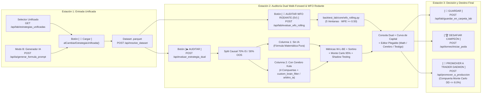

# 🗺️ MAPA LÓGICO Y ARQUITECTURA TÉCNICA · KULA BALAM

Este documento constituye la referencia técnica canónica del flujo de datos, reglas algorítmicas, modelos de decisión de Inteligencia Artificial y gobernanza de riesgo del ecosistema **Kula Balam**. Ha sido auditado contra el código fuente real del repositorio.

---

## 1. Diagrama del Flujo de una Señal (De Punta a Punta)

El recorrido de una señal describe el ciclo de vida continuo desde la ingesta de velas en el mercado hasta el asiento contable por partida doble en `trading_ledger.sqlite3`.

### 1.1 Diagrama de Secuencia y Tubería Cuantitativa

```mermaid
flowchart TD
    subgraph S1["1. Sincronización y Ciclo Temporal"]
        D1["daemon.py<br/>TraderDaemon._run_loop()"] --> D2["daemon.py<br/>_execute_cycle()"]
        D2 --> R1["radar_inbox.py<br/>_check_radar_for_autorouting()"]
        D2 --> B1["execution/paper_broker.py<br/>fetch_positions()"]
        B1 --> G1["daemon.py<br/>_check_open_positions_protections()<br/>(Guardián Trailing Stop & Decaimiento)"]
    end

    subgraph S2["2. Selección y Filtrado de Universo"]
        G1 --> SEL1["selectors.py<br/>select_crypto_slot()<br/>(Fuerza Relativa 7D SOL vs ETH)"]
        G1 --> MB1["macro_bias_buffer.py<br/>MacroBiasBuffer.get_all_active()"]
        SEL1 & MB1 --> H1["estrategias/registry.py<br/>is_asset_market_open()<br/>(Horarios NYSE, BYMA, Forex, Cripto)"]
    end

    subgraph S3["3. Ingesta y Análisis Cuantitativo"]
        H1 --> P1["backend/main.py:get_price()<br/>Precio fresco de mercado"]
        P1 --> AN1["backend/main.py:get_analysis()<br/>Validación y descarga OHLCV cerrada"]
        AN1 --> IND1["backend/main.py:compute_technical_indicators()<br/>RSI, ATR, EMA, SMA, VWAP, Bollinger"]
        IND1 --> MR1["market_regime.py<br/>classify_market_regime()<br/>(ADX, Pendiente EMA200, Percentil ATR 100)"]
        MR1 --> EST1["backend/estrategias/*.py<br/>evaluate_strategy_metrics()<br/>(Fórmula activa o resolve_auto_strategy)"]
        EST1 --> KR1["kula_rules.py<br/>evaluate_kula_trigger()<br/>(Tríada 1D·1H·5M + Fibo 0.50-0.75)"]
        KR1 --> CA1["candlestick_auditor.py<br/>audit_candlestick_confluence()<br/>(Geometría Bulkowski + Wyckoff RVOL)"]
    end

    subgraph S4["4. Confirmación por IA (Opcional si Engine != local)"]
        CA1 --> AI1{"Motor IA Activo?<br/>(antigravity_operador / gemini / ollama)"}
        AI1 -- "Sí" --> AI2["backend/main.py:2121-2170<br/>Inyección Prompt, Costos y Directivas AGENTS.md"]
        AI1 -- "No / Local" --> SIG1["Dictamen de Señal<br/>(COMPRAR / VENDER / MANTENER)"]
        AI2 --> SIG1
    end

    subgraph S5["5. Compuerta de Entrada, Gestión de Riesgo y Árbitro On-Demand"]
        SIG1 --> EG1["entry_gate.py<br/>entry_gate_failures()<br/>(Veto BTC 1H/VWAP, Cuchillo, R:R >= 2.0, ATR)"]
        EG1 -- "Veto Físico" --> BLK["Orden Rechazada / Registro en Logs"]
        EG1 -- "Aprobado" --> ARB1["arbiter_funnel.py:arbitrate_signal()<br/>(Colector news_collector.py RSS On-Demand)"]
        ARB1 -- "Veto Informativo / AHORA_NO" --> SHD1["db/ledger.py:open_shadow_trade()<br/>Tabla #19: shadow_trades (Shadow Testing)"]
        ARB1 -- "Aprobado / OPERAR" --> QR1["quant_risk.py<br/>calculate_vault_scaled_risk()<br/>(Piso Trinquete Bóveda vs Acumulación)"]
        QR1 --> QR2["quant_risk.py<br/>risk_sized_qty()<br/>(Volumen ajustado al SL neto)"]
    end

    subgraph S6["6. Ejecución y Partida Doble SQLite"]
        QR2 --> EXE1["execution/paper_broker.py<br/>place_entry() & place_protection()"]
        EXE1 --> DB1["db/ledger.py<br/>open_trade_with_jit()<br/>(Fondeo JIT desde Bóveda)"]
        DB1 --> SQL1[("trading_ledger.sqlite3<br/>tablas: trades & ledger_entries")]
    end
```



---

### 1.2 Recorrido Paso a Paso en el Código Fuente

1. **Latido del Ciclo y Aislamiento de Temporalidad (`backend/daemon.py` líneas 3240-3317):**
   - El bucle `_run_loop()` despierta periódicamente según la temporalidad activa y la existencia de posiciones abiertas (`_compute_next_wakeup_delay()`).
   - El modo autónomo de fondo (`strategy = "auto"`) opera aislado en **`4h`**; las temporalidades rápidas (`5m`/`15m`) quedan reservadas exclusivamente para sesiones de `operador_presente/` y para la evaluación paralela virtual (`EVAL_PARALELA`).
   - Invoca a `_execute_cycle()` (línea 2102) y, inmediatamente después en modo `auto` sin sesión presencial activa, ejecuta `_run_parallel_presencial_shadow_eval()` (línea 559).

2. **Inspección de Radar y Posiciones Vigentes (`backend/daemon.py` líneas 2102-2175):**
   - Llama a `_check_radar_for_autorouting()` para evaluar si ingresó una oportunidad de alta convicción en `buzon_radar.json`.
   - Consulta las posiciones abiertas en la base de datos a través de `broker.fetch_positions()` y actualiza cierres SL/TP/expiración 24h de `shadow_trades` (tanto vetos del Árbitro IA como simulaciones `EVAL_PARALELA`).
   - Si el mercado de un activo en cartera está cerrado según `backend/estrategias/registry.py:is_asset_market_open()`, se marca en hibernación para evitar liquidaciones fuera de rueda.

3. **Guardián de Protecciones Activas (`backend/daemon.py` líneas 1306-1820):**
   - `_check_open_positions_protections()` evalúa el Trailing Stop adaptativo, la activación de Breakeven real (`be_armed`), el peluqueo parcial (TP1 al 50% en estrategias Ruiz/Cava) y el decaimiento temporal (`time_decay_status`: tightening a las 8h y 16h sin avance).
   - Si una posición toca Stop Loss o Take Profit, `self.broker.flatten()` la liquida inmediatamente y finaliza la rama para ese activo.

4. **Selección de Activos Operables (`backend/selectors.py` y `backend/daemon.py` líneas 1715-1775):**
   - Si la estrategia es `donchian_breakout_1h`, el sistema restringe el escaneo a las listas blancas formales: `DONCHIAN_CRYPTO_WHITELIST` (`SOL/USDT`, `ETH/USDT` en 4H) y `DONCHIAN_TRADFI_WHITELIST` (`AAPL`, `AMD`, `AVGO`, `META`, `MSFT` en 1D).
   - En el slot cripto alternativo, `backend/selectors.py:select_crypto_slot()` compara la Fuerza Relativa a 7 días (168 períodos en 1H) entre SOL y ETH. Si existe una posición abierta, congela la rotación; si no hay posición y `RS > 1.10`, prioriza `SOL/USDT`.
   - Incorpora activos con directiva vigente desde `backend/macro_bias_buffer.py:MacroBiasBuffer.get_all_active()`.

5. **Descarga de Datos y Formación de Indicadores (`backend/main.py` líneas 1675-1850):**
   - El daemon genera una petición interna a `get_analysis()`.
   - Se descargan las velas mediante `get_ohlcv()`. Se descarta la vela abierta en formación (`_closed_ohlcv_data()`) para eliminar cualquier sesgo de tick incompleto.
   - Se valida continuidad temporal (`_validate_ohlcv_continuity()`).
   - `compute_technical_indicators()` calcula RSI(14), ATR(14), EMA(200), SMA(20), SMA(50), MACD y VWAP acumulado.
   - `_attach_multitemporal_frames()` adjunta marcos superiores (1H y 1D) al diccionario de indicadores.

6. **Clasificación de Régimen de Mercado (`backend/market_regime.py` líneas 129-180):**
   - `classify_market_regime(df)` audita la fuerza tendencial con ADX(14), la pendiente porcentual de la EMA 200 a 10 velas y el percentil histórico de ATR(14) en 100 velas.
   - Si el percentil de ATR supera el 90% o el ratio frente a su media de 20 períodos es $\ge 1.75$, dictamina régimen de **Crisis** y activa el veto determinista (`veto_active = True`).

7. **Evaluación de la Fórmula Matemática (`backend/estrategias/`):**
   - `backend/main.py:evaluate_strategy_metrics()` ejecuta la estrategia asignada (`kula_balam_cava_ruiz`, `donchian_breakout_1h`, `tres_velas_wyckoff_bulkowski`, etc.).
   - Si la configuración es `strategy = "auto"`, interviene `backend/estrategias/registry.py:resolve_auto_strategy()` conmutando por horario de sesión y Z-Score.

8. **Filtro del Portero Kula Balam y Conmutador Dinámico (`backend/kula_rules.py` líneas 35-245):**
   - `evaluate_kula_trigger()` comprueba la Tríada 1D-1H-5M:
     - 1D vs EMA 50 diaria.
     - 1H: Cierre vs EMA 50 y alineación EMA 21 vs EMA 89.
     - Retroceso dentro de la Zona Dorada Fibonacci $[0.50, 0.75]$ (invalida si perfora el 0.75).
     - **Conmutador de Volatilidad Táctica (Regla 4):**
       * Si $ATR(14) > SMA(ATR, 20) \implies$ régimen `EXPANSION` (retrocesos Kula/Cava).
       * Si $ATR(14) \le SMA(ATR, 20) \implies$ régimen `COMPRESSION`, conmutando automáticamente el reporte primario hacia `donchian_breakout_1h` en compresión (Squeeze BBW percentil $\le 10\%$).
     - **Veto Universal Antitrampas de Mechas (`check_universal_wick_veto`):** Si la última vela cerrada presenta una mecha contraria $\ge 50\%$ del rango total de la vela, veta categóricamente cualquier entrada.

9. **Auditoría Cuantitativa de Velas (`backend/candlestick_auditor.py` líneas 250-415):**
   - `audit_candlestick_confluence()` evalúa en 0 tokens los 15 patrones de Thomas Bulkowski, el volumen relativo Wyckoff ($RVOL$), divergencias en RSI(14) y compresión ATR squeeze.
   - Cruza el dictamen con `backend/macro_bias_buffer.py`.

10. **Arbitraje y Confirmación por IA (`backend/main.py` líneas 1975-2175):**
    - Si el motor es `antigravity_operador` o `antigravity_cio`, evalúa la directiva macro resuelta en `_resolve_active_macro_directive()`.
    - Si el motor es `gemini` o `ollama`, formatea el prompt cuantitativo estricto inyectando comisiones, spread, precedentes ganadores y directivas de `AGENTS.md`, exigiendo respuesta en JSON estricto.

11. **Compuerta de Entrada y Árbitro On-Demand (`backend/entry_gate.py` y `backend/arbiter_funnel.py`):**
    - Antes de colocar la orden, `entry_gate_failures()` realiza la auditoría de seguridad:
      - **Veto Macro BTC:** Si BTC cotiza bajo EMA200 1H o bajo VWAP diario, bloquea compras LONG en altcoins.
      - **Veto Centinela Cuchillo Cayendo:** Vela bajista con mecha inferior $< 15\%$ del rango prohíbe compras.
      - **Asimetría Matemática:** Exige $R:R \ge 1:2.0$ neto de comisiones y spread.
      - **Piso de Ruido ATR:** Exige que el Stop Loss sea $\ge 1.35 \times ATR$ (`SL_ATR_NOISE_MULTIPLIER = 1.35`, permitiendo SL 1.40x en Donchian).
      - **Filtro de Liquidez:** Rechaza si $RVOL < 0.70$ o si el spread supera el umbral máximo.
      - **Blackouts Horarios:** Veto de apertura (primeros 15 min de Wall Street), pre-cierre (últimos 15 min) y trampa de apertura dominical de Forex (18:00-21:00 ARG).
    - **Árbitro On-Demand y Vector de Impacto (`backend/arbiter_funnel.py:arbitrate_signal`):**
      - Se ejecuta exclusivamente en el segundo exacto en que la fórmula matemática dispara señal de entrada (1% de los ciclos).
      - **Sensor Quirúrgico On-Demand (`backend/news_collector.py`):**
        * Inspecciona tarjetas y peligros en vivo del Monitor del Mercado (`http://127.0.0.1:8520/api/reports/latest`).
        * Ejecuta consultas RSS booleanas dirigidas en Google News según la clase de activo (`CRYPTO`, `FOREX`, `EQUITY_US`).
        * Ingiere índices institucionales ($0.00 costo): `^VIX`, `^VXN`, `DXY` (Yahoo Chart API), Derivados Binance (Funding Rate spot/futuro y Open Interest Delta), Crypto Fear & Greed y Buffer Macro CIO (`backend/macro_bias_buffer.py`).
        * Caché TTL en memoria de 300 segundos y política estricta fail-open ante cortes de red o timeouts (3.5s titulares, 2.5s índices).
      - **Construcción del Vector de Impacto (`impact_vector`):**
        * `nlp_sentiment_score`: Calificación NLP heurística cuantitativa (-100 a +100).
        * `event_type`: Clasificación taxativa (`SYSTEMIC_SHOCK`, `ASSET_HAZARD`, `DIRECTIONAL_CATALYST`, `VIX_PANIC`, `NONE`).
        * `implied_bias`: Sesgo direccional derivado (`ALCISTA`, `BAJISTA`, `CLIMA_VOLATILIDAD`, `NEUTRAL`).
        * `near_4h_close`: Detección de ventana de cierre en los últimos 30 minutos de la barra 4H.
      - **Compuertas de Veto Institucional:**
        * **Veto de Titulares de Choque:** Reglas de texto ante cisnes negros, quiebras o hackeos -> `AHORA_NO` con prefijo `"Veto Árbitro Informativo: "`.
        * **Veto de Pánico VIX (LONGs):** Si TradFi tiene `VIX >= 28.5` o suba intradiaria $\ge +12\%$; o si Cripto tiene `VIX >= 32.0` y suba $\ge +15\%$ -> `AHORA_NO`.
        * **Veto Macro Buffer / Crisis:** Directiva `PELIGRO` en el buffer macro o régimen de crisis activo -> `AHORA_NO`.
        * **Veto Cierre 4H bajo Volatilidad:** Si faltan $< 30$ min para el cierre de barra 4H y existe `CLIMA_VOLATILIDAD` o `VIX >= 25.0` con $R:R < 2.30$ -> `AHORA_NO`.
      - **Aislamiento en Shadow Testing:** Desvía la operación virtual a la **Tabla #19 `shadow_trades`** para auditar el Drawdown Ahorrado vs. Ganancia Perdida, manteniendo 100% blindadas las cuentas y bóvedas reales.
      - Si ninguna compuerta veta la señal, dictamina `"OPERAR"` adjuntando el `impact_vector` completo.

12. **Dimensionamiento Cuantitativo de Riesgo (`backend/quant_risk.py`):**
    - `calculate_vault_scaled_risk()` determina el presupuesto en USD arriesgado por trade según el saldo consolidado de la Bóveda Kula.
    - `risk_sized_qty()` calcula el tamaño exacto de la posición para que, ante el impacto del Stop Loss neto, no se exceda el presupuesto de riesgo.

13. **Ejecución y Asiento Contable (`backend/execution/paper_broker.py` y `backend/db/ledger.py`):**
    - `PaperBrokerAdapter.place_entry()` transfiere el capital Just-In-Time (JIT) desde la cuenta `VAULT_USDT` hacia `OP_USDT`.
    - Registra el débito por comisiones devengadas en `FEES_EXPENSE_USDT`.
    - Inserta el registro del trade en la tabla `trades` de `trading_ledger.sqlite3` bajo estándar ACID con WAL habilitado (protegido por el índice único `one_open_trade_per_symbol`).
    - `PaperBrokerAdapter.place_protection()` coloca las órdenes virtuales de Stop Loss y Take Profit.

14. **Evaluación Paralela Virtual de Presencial (`backend/daemon.py:559-722` y `backend/db/ledger.py:2518-2526`):**
    - Tras cada ciclo de `auto`, `_run_parallel_presencial_shadow_eval()` evalúa una vez por vela (deduplicación por bucket temporal en `_parallel_shadow_last_bucket`) los objetivos configurados en `backend/config/campaign_config.json` (`fractal_squeeze_15m`, `mtf_presencial_15m`, `mtf_presencial_5m`).
    - Registra telemetría en `signals` con `stage = "parallel_shadow"` y, ante señal elegible, abre una posición 100% virtual en `shadow_trades` con `arbiter_verdict = "EVAL_PARALELA"`, deduplicada por `(symbol, strategy, side, arbiter_verdict)`.
    - No escribe en `trades`, no ocupa slots de `one_open_trade_per_symbol`, no altera `VAULT_USDT` y queda estrictamente segregada del Edge del Árbitro IA (`VETO_ARBITRO_IA` / `AHORA_NO`).

---

## 2. Dónde Están las Reglas de las IAs

Esta sección mapea los archivos exactos y rangos de líneas que gobiernan los prompts, las decisiones heurísticas de los modelos y la comunicación inter-agente.

```
📁 PROMPTS Y REGLAS DE IA
├── 📄 backend/main.py:2121-2170        ──> Prompt Cuantitativo Gemini / LLMs (Fricción, Métricas, JSON)
├── 📄 backend/main.py:1975-2080        ──> Motor Antigravity CIO & Operador Táctico
├── 📄 backend/main.py:710-725          ──> Ingesta Canónica de Directivas (_shared_brain_directives)
├── 📄 backend/news_collector.py        ──> Colector RSS On-Demand (Monitor 8520 / TTL 300s)
├── 📄 backend/arbiter_funnel.py        ──> Embudo de Arbitraje On-Demand (Veto AHORA_NO & Fail-Open)
├── 📄 backend/daemon.py:1560-1820      ──> Llave Adaptativa IA: Modo Holgado vs. Modo Comprimido y Contrafáctico
├── 📄 backend/daemon.py:559-722        ──> Evaluación Paralela Virtual (EVAL_PARALELA) para Presencial 15m/5m
├── 📄 backend/radar_inbox.py:54-150    ──> Lectura, TTL y Deduplicación de buzon_radar.json
├── 📄 backend/macro_bias_buffer.py     ──> Almacén de Sesgos Macro con Latencia de Absorción
├── 📄 backend/campaign_audit.py        ──> Auditoría Cuantitativa de Campaña (0 tokens, read-only SQLite)
├── 📄 backend/health_watchdog.py       ──> Semáforo de Salud y Auto-test Sintético de Fórmulas (0 tokens)
├── 📄 backend/rejection_funnel.py      ──> Normalizador de Señales y Embudo de Rechazos 24H/30D
├── 📄 backend/config/directivas_cio.md ──> Doctrina Canónica del CIO (Tríada Kula & Rol Balam)
└── 📄 AGENTS.md                        ──> Directivas Globales del Ecosistema
```

### 2.1 Prompt del Analista Cuantitativo (Gemini / AI)
- **Archivo:** [`backend/main.py`](file:///home/raul/Escritorio/proyectos/kula_balam/backend/main.py#L2121-L2170)
- **Líneas:** 2121 a 2170
- **Estructura inyectada en el prompt:**
  - Directivas canónicas globales (`AGENTS.md`).
  - Contexto macro en vivo (`backend/config/contexto_macro.md`).
  - Costos exactos del broker (comisión por orden, ida y vuelta, spread por lado, costo total de fricción y ganancia neta proyectada).
  - Estructura técnica del activo: Precio, VWAP, EMA 200 y su pendiente, RSI(14), MACD, Bandas Bollinger, ratio de mecha inferior.
  - Bloque determinista (`quant_prompt_block`): Restricción que prohíbe al LLM recalcular números o inventar señales; su autoridad se limita a vetar si detecta contradicciones contextuales severas.
  - Precedentes ganadores obtenidos desde `backend/verificador_evolutivo.py`.
  - Reglas anti-overtrading (prohibición de comprar sobre posición abierta o salir sin cubrir el beneficio mínimo).
  - Esquema estricto de salida en formato JSON: `{"signal": "COMPRAR"|"VENDER"|"MANTENER", "reason": "..."}`.

### 2.2 Motor Antigravity CIO y Operador Táctico
- **Archivo:** [`backend/main.py`](file:///home/raul/Escritorio/proyectos/kula_balam/backend/main.py#L1975-L2080)
- **Líneas:** 1975 a 2080
- **Lógica de decisión:**
  - `antigravity_cio`: Requiere una directiva macro de alta convicción ($\ge 75\%$) en `buzon_radar.json` o `macro_bias_buffer.json` para autorizar una compra. Si no existe tesis activa, mantiene 100% liquidez en caja.
  - `antigravity_operador`: Opera de manera cuantitativa autónoma guiado por las métricas de las estrategias, pero acatando cualquier veto macro o de régimen de volatilidad.

### 2.3 Llave Adaptativa del Trailing Stop (Modo Holgado vs. Comprimido)
- **Archivo:** [`backend/daemon.py`](file:///home/raul/Escritorio/proyectos/kula_balam/backend/daemon.py#L1560-L1820)
- **Líneas:** 1560 a 1820 (telemetría `counterfactual_diff` en líneas 1667-1816)
- **Mecánica Cuantitativa:**
  - **Distancias por Escalón:**
    - Pico $\ge +8.0\%$: Holgado $1.20\%$, Comprimido $0.80\%$.
    - Pico $\ge +4.0\%$: Holgado $1.50\%$, Comprimido $1.00\%$.
    - Pico $\ge +1.50\%$: Holgado $1.50\%$, Comprimido $1.20\%$.
  - **Reglas del Modo AUTO (Líneas 1170-1230):**
    1. **Clímax de Impulso:** Si el pico de ganancia bruta supera el umbral clímax ($+8.0\%$ en Cripto/Acciones, $+1.5\%$ en Micro-Futuros o Forex), conmuta a **COMPRIMIDO** para asegurar la cima o valle.
    2. **Agotamiento por Oscilador:** Si el RSI(14) alcanza zona extrema ($\ge 70.0$ en Longs o $\le 30.0$ en Shorts), activa **COMPRIMIDO** ante riesgo inminente de giro.
    3. **Maduración de Tendencia:** Si el pico $\ge +1.20\%$ ($+0.45\%$ en forex) con RSI tenso ($\ge 60$ o $\le 40$), activa **COMPRIMIDO**.
    4. **Desarrollo Saludable:** Si la tendencia avanza sin sobreextensión, permanece en **HOLGADO** permitiendo que el activo continúe su desarrollo.
  - **Telemetría Contrafáctica (What-If) (Líneas 1215-1250):**
    - Calcula en cada pasada: `counterfactual_diff_pct = chosen_net_pct - alt_net_pct`.
    - Estima el diferencial monetario en USD y lo almacena en `trades.counterfactual_diff` para ser auditado forensemente por `auditar_sqlite.py`.

### 2.4 Ingesta de Señales del Radar y Buffer Macro
- **Lectura del Buzón:** [`backend/radar_inbox.py`](file:///home/raul/Escritorio/proyectos/kula_balam/backend/radar_inbox.py#L54-L150) (Líneas 54-150).
  - Gestiona `buzon_radar.json` en la raíz.
  - Implementa deduplicación estricta por par `(activo, titular)` en ventanas de 6 horas y purga tarjetas vencidas por TTL (por defecto 72 horas).
- **Buffer de Sesgo con Latencia de Absorción:** [`backend/macro_bias_buffer.py`](file:///home/raul/Escritorio/proyectos/kula_balam/backend/macro_bias_buffer.py#L75-L145) (Líneas 75-145).
  - Gestiona `backend/config/macro_bias_buffer.json`.
  - Concede una ventana de absorción de 2.5 horas para permitir que el mercado asimile noticias sin forzar ejecuciones en pleno pico de volatilidad de apertura. Si no recibe confluencia técnica en ese plazo, descarta la señal en silencio (`DISCARDED_EXPIRED`).
- **Resolución Unificada de Directivas:** [`backend/main.py`](file:///home/raul/Escritorio/proyectos/kula_balam/backend/main.py#L1512-L1615) (Líneas 1512-1615) en `_resolve_active_macro_directive()`.

### 2.5 Árbitro Informativo On-Demand, Índices Institucionales ($0.00) y Vector de Impacto
- **Archivos:** [`backend/news_collector.py`](file:///home/raul/Escritorio/proyectos/kula_balam/backend/news_collector.py) y [`backend/arbiter_funnel.py`](file:///home/raul/Escritorio/proyectos/kula_balam/backend/arbiter_funnel.py)
- **Operativa Quirúrgica On-Demand:** Se dispara en el segundo exacto en que una fórmula matemática genera señal de entrada (1% de los ciclos), evitando sondeos pasivos y sobrecarga de red.
- **Sensor Multifuente de Noticias e Índices:**
  - *Monitor del Mercado:* Lee tarjetas y alertas de peligro en `http://127.0.0.1:8520/api/reports/latest`.
  - *Google News RSS Específico:* Ejecuta consultas booleanas con pares y palabras clave dirigidas según la clase del activo (`CRYPTO`, `FOREX`, `EQUITY_US`).
  - *Índices Gratuitos en Tiempo Real ($0.00):* Consulta `^VIX`, `^VXN`, `DXY` vía Yahoo Chart API, métricas de derivados en Binance Futures (Funding Rate y Delta de Interés Abierto), Crypto Fear & Greed y Buffer Macro local.
  - *Caché TTL:* 300 segundos en memoria para noticias e índices. Fail-open estricto ante timeouts (3.5s noticias, 2.5s índices).
- **Vector de Impacto Estructurado (`impact_vector`):**
  - Genera `nlp_sentiment_score` (-100 a +100), `event_type` (`SYSTEMIC_SHOCK`, `ASSET_HAZARD`, `DIRECTIONAL_CATALYST`, `VIX_PANIC`, `NONE`), `implied_bias` (`ALCISTA`, `BAJISTA`, `CLIMA_VOLATILIDAD`, `NEUTRAL`) y bandera de ventana crítica `near_4h_close` (últimos 30 min de la vela 4H).
- **Compuertas de Veto del Árbitro:**
  - **Pánico VIX en LONGs:** VIX $\ge 28.5$ o $\Delta \ge +12\%$ (TradFi); VIX $\ge 32.0$ y $\Delta \ge +15\%$ (Cripto).
  - **Buffer Macro en Peligro:** Veto si existe directiva `PELIGRO` o régimen de `CRISIS` activo.
  - **Cierre 4H bajo Volatilidad:** Veto si faltan $< 30$ min para el cierre de barra 4H y el sesgo es `CLIMA_VOLATILIDAD` o VIX $\ge 25.0$ con $R:R < 2.30$.
- **Aislamiento Shadow Testing (Tabla #19):** Todo veto `"AHORA_NO"` (con prefijo canónico `"Veto Árbitro Informativo: "`) desvía la operación virtualmente a `shadow_trades` para auditar el Drawdown Ahorrado vs. Ganancia Perdida sin arriesgar un solo centavo de las bóvedas reales. Retorna `"OPERAR"` con `impact_vector` cuando no hay invalidación institucional.

---

## 3. Dónde Están las Reglas del Portero Balam (Tríada 1D·1H·5M)

El Portero Balam representa la compuerta determinista que custodia la entrada al mercado. Combina análisis fractal con confluencia geométrica de velas.

```
📁 ARQUITECTURA DEL PORTERO BALAM
├── 📄 backend/kula_rules.py             ──> Gatillo Multivariable y Reglas Fractal 1D-1H-5M
├── 📄 backend/candlestick_auditor.py    ──> Benchmark Bulkowski (4.7M velas) + Wyckoff VPA
├── 📄 modulo_tres_velas/                ──> Terminal Desacoplada y Módulo Visual Standalone
│   ├── 📄 estrategia_tres_velas.py      ──> Adaptador portable hacia backend.estrategias
│   ├── 📄 cockpit.js                    ──> Motor visual de análisis de velas
│   └── 📄 index.html                    ──> Dashboard interactivo independiente
└── 📄 backend/estrategias/kula_balam_cava_ruiz.py ──> Fusión con doctrina de José Luis Cava
```

### 3.1 Anatomía de `backend/kula_rules.py`
Función central: `evaluate_kula_trigger()` ([`backend/kula_rules.py`](file:///home/raul/Escritorio/proyectos/kula_balam/backend/kula_rules.py#L35-L230), líneas 35 a 230).

- **Regla 0 · Contexto Macro Diario (1D vs EMA 50) (Líneas 90-112):**
  - Evalúa la estructura secular en velas diarias.
  - Para posiciones LONG: Exige que el cierre diario se sitúe sobre o dentro del margen de la media: $Close_{1D} \ge 0.998 \times EMA50_{1D}$.
  - Para posiciones SHORT: Exige que el cierre diario confirme debilidad: $Close_{1D} \le 1.002 \times EMA50_{1D}$.
- **Regla 1 · Filtro Direccional Táctico en 1H (Líneas 114-126):**
  - LONG: $Close_{1H} > EMA50_{1H}$.
  - SHORT: $Close_{1H} < EMA50_{1H}$.
- **Regla 2 · Alineación Tendencial en 1H (Líneas 128-142):**
  - LONG: $EMA21_{1H} > EMA89_{1H}$ (abanico alcista).
  - SHORT: $EMA21_{1H} < EMA89_{1H}$ (abanico bajista).
- **Regla 3 · Retroceso en la Zona Dorada de Fibonacci (Líneas 144-184):**
  - Mide el impulso previo entre el swing high y swing low reciente.
  - Para compras: El precio debe ubicarse estrictamente en la franja $[0.50, 0.75]$ del retroceso.
  - **Invalidación Categórica:** Si el precio perfora por debajo del nivel 0.75, la tesis de retroceso queda anulada por estructura rota.
- **Regla 4 · Conmutador Táctico de Volatilidad (5M / Táctico) (Líneas 186-215):**
  - Evalúa la compresión de volatilidad táctica mediante $ATR(14) > SMA(ATR, 20)$:
    * Si $ATR > SMA$: Retorna régimen `EXPANSION`. Habilita la búsqueda de retrocesos en `kula_balam_cava_ruiz` (Tríada 1D-1H-5M + Zona Dorada Fibonacci).
    * Si $ATR \le SMA$: Retorna régimen `COMPRESSION`. Conmuta automáticamente el reporte primario hacia `donchian_breakout_1h` para capturar la ruptura post-compresión (con `bbw_pct_rank` y percentil $\le 10\%$).
- **Veto Universal Antitrampas de Mechas (`check_universal_wick_veto`, líneas 218-245):**
  - Verifica en la última vela cerrada si la mecha contraria (superior en LONG, inferior en SHORT) es $\ge 50\%$ del rango total de la vela. De ser así, veta la entrada determinísticamente para todas las estrategias del sistema.

### 3.2 Anatomía de `backend/candlestick_auditor.py`
Función central: `audit_candlestick_confluence()` ([`backend/candlestick_auditor.py`](file:///home/raul/Escritorio/proyectos/kula_balam/backend/candlestick_auditor.py#L250-L415), líneas 250 a 415).

- **Geometría de Thomas Bulkowski (Líneas 18-200):**
  - Clasifica patrones analizando las últimas 3 velas cerradas según el atlas empírico de más de 4.7 millones de velas:
    - *Three White Soldiers* (82% continuidad alcista).
    - *Three Black Crows* (79% cascada bajista).
    - *Morning Star* (78% reversión alcista).
    - *Evening Star* (72% reversión bajista).
    - *Bullish / Bearish Engulfing* (63% - 65% reversión).
    - *Hammer / Shooting Star* (59% - 60% rechazo de extremos).
- **Volumen Wyckoff VPA (Líneas 280-290):**
  - Evalúa el Volumen Relativo ($RVOL$): Si $RVOL \ge 1.8$, suma $+10\%$ al factor de confianza por presencia institucional; si $RVOL < 0.65$, resta $-10\%$ por desinterés del dinero inteligente.
- **Divergencias en Oscilador RSI(14) (Líneas 202-248):**
  - Detecta divergencias regulares entre precio y RSI. Bonifica con $+15\%$ la confianza si hay divergencia alcista en soporte, o penaliza con $-15\%$ si detecta divergencia bajista en techo.
- **Filtro de Compresión ATR Squeeze (Líneas 270-278):**
  - Si $ATR(14) < 0.70 \times SMA(ATR, 20)$, veta patrones de continuación alcista para proteger la cuenta contra falsas rupturas (*whipsaws*).

### 3.3 Conexión con la Carpeta `modulo_tres_velas/`
- La carpeta `modulo_tres_velas/` fue diseñada con arquitectura modular para permitir su exportación o ejecución independiente.
- `modulo_tres_velas/estrategia_tres_velas.py` actúa como puente que reexporta `EstrategiaTresVelas` desde `backend/estrategias/tres_velas_wyckoff_bulkowski.py`.
- `modulo_tres_velas/cockpit.js` e `index.html` ofrecen la interfaz visual gráfica donde el operador humano o la IA pueden monitorear las velas japonesas, la Zona Dorada de Fibonacci y el estado de validación del Portero Balam en tiempo real.
- `backend/estrategias/kula_balam_cava_ruiz.py` (líneas 485-505) importa directamente a `kula_rules.py` para contrastar las reglas 0 a 4 antes de habilitar el gatillo de parqué de Cava (quiebre de directriz 2-4 y fallo de MACD).

---

## 4. Catálogo de Fórmulas Matemáticas (`backend/estrategias/`)

### 4.0 Cartera Activa en Producción (`auto [4h]` · 9 Fórmulas Certificadas sobre `VAULT_USDT`)

Configurada en [`backend/config/daemon_state.json`](file:///home/raul/Escritorio/proyectos/kula_balam/backend/config/daemon_state.json) y verificada por el auto-test sintético de `backend/health_watchdog.py` (`9/9 OK`):

| # | Estrategia ID | Archivo de Implementación | Activo / TF Nativo | Enfoque |
| :-: | :--- | :--- | :--- | :--- |
| 1 | **`kula_balam_cava_ruiz`** | [`kula_balam_cava_ruiz.py`](file:///home/raul/Escritorio/proyectos/kula_balam/backend/estrategias/kula_balam_cava_ruiz.py) | Multi-activo / 1H–4H | Tríada 1D-1H-5M + Fibo 0.50–0.75 + doctrina de parqué Cava. |
| 2 | **`1_donchian_breakout_sol_4h`** | [`1_donchian_breakout_sol_4h.py`](file:///home/raul/Escritorio/proyectos/kula_balam/backend/estrategias/catalogo/principal/1_donchian_breakout_sol_4h.py) | `SOL/USDT` · `4h` | Ruptura Donchian estructural calibrada para SOL en 4H. |
| 3 | **`2_squeeze_dual_eth_4h`** | [`2_squeeze_dual_eth_4h.py`](file:///home/raul/Escritorio/proyectos/kula_balam/backend/estrategias/catalogo/principal/2_squeeze_dual_eth_4h.py) | `ETH/USDT` · `4h` | Squeeze de volatilidad dual (Long/Short) sobre ETH 4H. |
| 4 | **`donchian_breakout_1h`** | [`donchian_breakout_1h.py`](file:///home/raul/Escritorio/proyectos/kula_balam/backend/estrategias/donchian_breakout_1h.py) | Cripto 4H / TradFi 1D | Ruptura Donchian causal con salida desacoplada `MID_EXIT`. |
| 5 | **`cava_fallo_macd_eurusd_1h_slot1`** | [`cava_fallo_macd_eurusd_1h_slot1.py`](file:///home/raul/Escritorio/proyectos/kula_balam/backend/estrategias/catalogo/principal/cava_fallo_macd_eurusd_1h_slot1.py) | `EURUSD=X` · `1h` | Fallo de MACD / agotamiento Cava dedicado al slot Forex. |
| 6 | **`kula_cava_eth_1h`** | [`kula_cava_eth_1h.py`](file:///home/raul/Escritorio/proyectos/kula_balam/backend/estrategias/catalogo/principal/kula_cava_eth_1h.py) | `ETH/USDT` · `1h` | Variante Kula Cava & Ruiz certificada sobre ETH 1H. |
| 7 | **`kula_cava_sol_1h`** | [`kula_cava_sol_1h.py`](file:///home/raul/Escritorio/proyectos/kula_balam/backend/estrategias/catalogo/principal/kula_cava_sol_1h.py) | `SOL/USDT` · `1h` | Variante Kula Cava & Ruiz certificada sobre SOL 1H (promovida a `auto` en campaña). |
| 8 | **`ttm_squeeze_eth_1h`** | [`ttm_squeeze_eth_1h.py`](file:///home/raul/Escritorio/proyectos/kula_balam/backend/estrategias/catalogo/principal/ttm_squeeze_eth_1h.py) | `ETH/USDT` · `1h` | Compresión TTM Squeeze (BB dentro de Keltner) + momentum sobre ETH 1H. |
| 9 | **`ttm_squeeze_sol_4h`** | [`ttm_squeeze_sol_4h.py`](file:///home/raul/Escritorio/proyectos/kula_balam/backend/estrategias/catalogo/principal/ttm_squeeze_sol_4h.py) | `SOL/USDT` · `4h` | Compresión TTM Squeeze + desahogo direccional sobre SOL 4H. |

### 4.0b Catálogo de Operador Presencial (`backend/estrategias/catalogo/operador_presente/`)

Fórmulas destinadas a sesiones activas del operador y/o **Evaluación Paralela Virtual (`EVAL_PARALELA`)** sin consumo de slots de `auto`:

| Estrategia ID | Archivo de Implementación | Activo / TF Nativo | Modo en Campaña |
| :--- | :--- | :--- | :--- |
| **`fractal_squeeze_15m`** | [`fractal_squeeze_15m.py`](file:///home/raul/Escritorio/proyectos/kula_balam/backend/estrategias/catalogo/operador_presente/fractal_squeeze_15m.py) | `ETH/USDT` · `15m` (filtro `1h`) | Sesión Presencial (Londres/NY) + `EVAL_PARALELA` virtual. |
| **`mtf_presencial_15m`** | [`mtf_presencial_15m.py`](file:///home/raul/Escritorio/proyectos/kula_balam/backend/estrategias/catalogo/operador_presente/mtf_presencial_15m.py) | `ETH/USDT`, `SOL/USDT` · `15m` | Sesión Presencial + `EVAL_PARALELA` virtual. |
| **`mtf_presencial_5m`** | [`mtf_presencial_5m.py`](file:///home/raul/Escritorio/proyectos/kula_balam/backend/estrategias/catalogo/operador_presente/mtf_presencial_5m.py) | `ETH/USDT`, `SOL/USDT` · `5m` | Sesión Presencial + `EVAL_PARALELA` virtual. |
| **`cava_fallo_macd_eurusd_1h`** | [`cava_fallo_macd_eurusd_1h.py`](file:///home/raul/Escritorio/proyectos/kula_balam/backend/estrategias/catalogo/operador_presente/cava_fallo_macd_eurusd_1h.py) | `EURUSD=X` · `1h` | Presencial Forex (cubierta en `auto` vía `_slot1`). |

### 4.0c Catálogo Base y Laboratorio (`backend/estrategias/registry.py`)

El registro maestro ([`backend/estrategias/registry.py`](file:///home/raul/Escritorio/proyectos/kula_balam/backend/estrategias/registry.py#L35-L65)) mantiene además el inventario completo de estrategias base, de fondeo y de laboratorio:

| Estrategia ID | Archivo de Implementación | Categoría | Filosofía Matemática y Reglas Principales |
| :--- | :--- | :--- | :--- |
| **`donchian_breakout_1h`** | [`donchian_breakout_1h.py`](file:///home/raul/Escritorio/proyectos/kula_balam/backend/estrategias/donchian_breakout_1h.py) | **Titular Oficial** | Ruptura causal de Canales Donchian (30 períodos en 4H Cripto / 20 períodos en 1D Acciones). Filtro de compresión ATR, alineación con EMA200, veto anti-trampa de mecha y **salida desacoplada por línea media (`MID_EXIT`)**. |
| **`squeeze_dual_eth_4h`** | [`squeeze_dual_eth_4h.py`](file:///home/raul/Escritorio/proyectos/kula_balam/backend/estrategias/squeeze_dual_eth_4h.py) | **Titular Oficial** | Squeeze de volatilidad de John Carter aplicado a ETH/USDT en 4H. Bandas de Bollinger dentro de Canales Keltner; dispara en el desahogo de volatilidad con $R:R \ge 1:2.0$. |
| **`squeeze_dual_eth_fondeo_strict_4h`** | [`squeeze_dual_eth_fondeo_strict_4h.py`](file:///home/raul/Escritorio/proyectos/kula_balam/backend/estrategias/catalogo/para_testear/ganadoras/squeeze_dual_eth_fondeo_strict_4h.py) | **Apto Fondeo (Prop Firm)** | Variante institucional certificada para cuentas de fondeo (FTMO/Prop Firm Compliance: Max DD 6.50% $\le 8.0\%$, Daily DD 2.99% $\le 4.5\%$, $PF = 2.53$, OOS ciego $PF = 1.80$). Incorpora candado de volatilidad $(1.4 \times ATR / Close) \le 2.9\%$ y gancho extensible `custom_brain_filter`. |
| **`kula_balam_cava_ruiz`** | [`kula_balam_cava_ruiz.py`](file:///home/raul/Escritorio/proyectos/kula_balam/backend/estrategias/kula_balam_cava_ruiz.py) | **Titular Oficial** | Fusión de la Tríada Alex Ruiz (1D-1H-5M, Fibo 0.50-0.75) y la doctrina José Luis Cava (Clúster de volumen, agotamiento de Onda C, fallo de MACD, secado de volumen $RVOL < 0.85$, Stop a Misa y peluqueo TP1 al 50%). |
| **`tres_velas_wyckoff_bulkowski`** | [`tres_velas_wyckoff_bulkowski.py`](file:///home/raul/Escritorio/proyectos/kula_balam/backend/estrategias/tres_velas_wyckoff_bulkowski.py) | **Titular Oficial** | 15 patrones cuantitativos Bulkowski (>4.7M velas), filtro direccional VWAP intradía, anomalías Wyckoff y peluqueo a $2.5 \times ATR$. |
| **`alex_ruiz_triada_3velas`** | [`alex_ruiz_triada_3velas.py`](file:///home/raul/Escritorio/proyectos/kula_balam/backend/estrategias/alex_ruiz_triada_3velas.py) | Laboratorio | Tríada fractal pura Long & Short con vetos de Bear Trap (mecha inferior $\ge 40\%$), sobreventa $RSI \le 30$ y Stop adaptativo de parqué. |
| **`nasdaq_araujo_vwap`** | [`nasdaq_araujo_vwap.py`](file:///home/raul/Escritorio/proyectos/kula_balam/backend/estrategias/nasdaq_araujo_vwap.py) | Laboratorio | Especializada en apertura de Wall Street (09:30 - 11:30 NY). Rebote tendencial sobre VWAP institucional anclado a la sesión. |
| **`hyenuk_chu_multibagger`** | [`hyenuk_chu_multibagger.py`](file:///home/raul/Escritorio/proyectos/kula_balam/backend/estrategias/hyenuk_chu_multibagger.py) | Laboratorio | Detección de Velas Elefante institucionales con alineación de medias móviles (SMA 20, 50, 200) y toma de beneficios escalonada. |
| **`mean_reversion_atr`** | [`mean_reversion_atr.py`](file:///home/raul/Escritorio/proyectos/kula_balam/backend/estrategias/mean_reversion_atr.py) | Laboratorio | Reversión a la media gobernada por $Z\text{-Score}$: Camino 1 (Pullback en $[-1.2, -0.4]$) y Camino 2 (Pánico/Capitulación con $Z \le -2.0$). |
| **`trailing_trend_runner`** | [`trailing_trend_runner.py`](file:///home/raul/Escritorio/proyectos/kula_balam/backend/estrategias/trailing_trend_runner.py) | Laboratorio | Captura de tendencias alcistas de largo recorrido sin techo fijo mediante escalones móviles de Trailing Stop. |
| **`trailing_short_runner`** | [`trailing_short_runner.py`](file:///home/raul/Escritorio/proyectos/kula_balam/backend/estrategias/trailing_short_runner.py) | Laboratorio | Espejo simétrico para tendencias bajistas estructurales (Shorts de seguridad) con protección de capital. |
| **`triple_confluencia_4h`** | [`triple_confluencia_4h.py`](file:///home/raul/Escritorio/proyectos/kula_balam/backend/estrategias/triple_confluencia_4h.py) | Laboratorio | Confluencia en 4H entre soporte/resistencia, RSI y cruce dinámico de MACD. |
| **Familia de Scalping 5M** | [`scalping_cuantitativo_5m.py`](file:///home/raul/Escritorio/proyectos/kula_balam/backend/estrategias/scalping_cuantitativo_5m.py) | Scalping Presencial | 5 fórmulas de alta frecuencia para sesiones presenciales: `scalping_vwap_2sigma_5m`, `scalping_m5_rsi3_adx5_ema50`, `smc_liquidity_scalper_m5`, `triada_fractal_fibo_ema50_5m`, `donchian_15m_atr_runner`. |

### 4.1 Cómo Seleccionan la Estrategia `selectors.py` y `daemon.py`

El sistema no opera al azar ni delega la elección al arbitrio de la IA. La selección se rige por dos mecanismos deterministas:

1. **Auto-Orquestador por Régimen y Horario (`backend/estrategias/registry.py:resolve_auto_strategy`):**
   - Cuando la estrategia activa en el daemon es `"auto"`, se evalúa la siguiente jerarquía numérica en cada vela:
     1. **Prioridad Cuantitativa 1 (Pánico / Reversión):**
        - Si $Z\text{-Score} \le -2.0 \implies$ conmuta a `mean_reversion_atr` (Camino 2: Capitulación extrema).
        - Si $-1.2 \le Z\text{-Score} \le -0.4 \implies$ conmuta a `mean_reversion_atr` (Camino 1: Pullback en tendencia).
     2. **Prioridad Temporal 2 (Campana de Wall Street en EE. UU.):**
        - Lunes a Viernes de 09:30 a 11:30 NY $\implies$ conmuta a `nasdaq_araujo_vwap`.
        - Lunes a Viernes de 11:31 a 16:00 NY $\implies$ conmuta a `hyenuk_chu_multibagger`.
     3. **Prioridad Continua 3 (Cripto 24/7 y Forex 24/5):**
        - Audita el régimen estructural: si el precio cotiza bajo la EMA 200 con medias alineadas en cascada y $RSI \in [28, 50]$, conmuta a `trailing_short_runner`.
        - Si la tendencia sostiene la SMA 50 y $RSI \ge 40$, conmuta a `trailing_trend_runner`.
        - Si hay mecha de absorción $\ge 35\%$ y $RSI \le 45$, conmuta a `02_cazador_rebotes_atr_15m`.

2. **Rotación de Fuerza Relativa en Slot Cripto (`backend/selectors.py:select_crypto_slot`):**
   - Calcula el ratio de Fuerza Relativa ($RS$) a 7 días:
     $$RS = \frac{Retorno_{7D}(SOL)}{Retorno_{7D}(ETH)}$$
   - Si existe una posición abierta en cartera (`has_open_position = True`), **bloquea la rotación** y preserva el activo actual para no cortar el trade en curso.
   - Si no hay posición abierta:
     - Si $RS > 1.10 \implies$ selecciona `SOL/USDT`.
     - Si $RS \le 1.10 \implies$ selecciona `ETH/USDT`.

3. **Filtrado Estricto de Lista Blanca Donchian (`backend/daemon.py` líneas 1761-1770):**
   - Cuando opera bajo `donchian_breakout_1h`, el daemon rechaza categóricamente cualquier símbolo que no figure en `DONCHIAN_WHITELIST_TIMEFRAMES`, impidiendo ejecuciones espurias en temporalidades no validadas empíricamente.

---

## 5. Guía Rápida de Edición Manual

Esta tabla resume qué archivo y líneas exactas se deben abrir cuando se requiere calibrar un parámetro del sistema sin alterar la arquitectura global.

| Acción Deseada | Archivo Exacto a Modificar | Rango de Líneas / Parámetro Concreto |
| :--- | :--- | :--- |
| **a) Modificar los activos que patrulla el bot en 4H / 1D** | [`backend/daemon.py`](file:///home/raul/Escritorio/proyectos/kula_balam/backend/daemon.py#L47-L56)<br/>[`backend/estrategias/donchian_breakout_1h.py`](file:///home/raul/Escritorio/proyectos/kula_balam/backend/estrategias/donchian_breakout_1h.py#L60-L63) | **`backend/daemon.py` (Líneas 47-56):**<br/>`DONCHIAN_CRYPTO_WHITELIST = ("SOL/USDT", "ETH/USDT")`<br/>`DONCHIAN_TRADFI_WHITELIST = ("AAPL", "AMD", "AVGO", "META", "MSFT")`<br/>`DONCHIAN_WHITELIST_TIMEFRAMES`<br/>*Y en `donchian_breakout_1h.py` (Línea 60):* `activos_recomendados`. |
| **b) Modificar una regla del Portero Balam (Fibo o ATR)** | [`backend/kula_rules.py`](file:///home/raul/Escritorio/proyectos/kula_balam/backend/kula_rules.py#L90-L215)<br/>[`backend/estrategias/kula_balam_cava_ruiz.py`](file:///home/raul/Escritorio/proyectos/kula_balam/backend/estrategias/kula_balam_cava_ruiz.py#L63-L75) | **`backend/kula_rules.py`:**<br/>- Regla 0 (1D Macro): Líneas 90-112.<br/>- Regla 1 (Filtro 1H EMA 50): Líneas 114-126.<br/>- Regla 2 (Alineación EMA 21/89): Líneas 128-142.<br/>- **Regla 3 (Fibo 0.50-0.75): Líneas 144-184**.<br/>- **Regla 4 (Expansión ATR > SMA): Líneas 186-215**.<br/>*En `kula_balam_cava_ruiz.py`:* `fibo_golden_zone_min`, `fibo_golden_zone_max`. |
| **c) Ajustar multiplicadores de Stop Loss / Take Profit / R:R** | [`backend/quant_risk.py`](file:///home/raul/Escritorio/proyectos/kula_balam/backend/quant_risk.py#L411-L435)<br/>[`backend/daemon.py`](file:///home/raul/Escritorio/proyectos/kula_balam/backend/daemon.py#L2120-L2180) | **`backend/quant_risk.py`:**<br/>- Línea 411: `MIN_NET_RR = 1.5`<br/>- Línea 412: `TARGET_NET_RR = 2.0`<br/>- Línea 413: `SL_ATR_NOISE_MULTIPLIER = 1.35` (calibrado para Donchian SL 1.40x)<br/>- Línea 419: `VAULT_PROTECTION_FLOOR_USDT = 800.0`<br/>*En `daemon.py` (Líneas 2120-2180):* Niveles de TP y SL asignados por estrategia antes de emitir la orden. |
| **d) Modificar el arbitraje de noticias y directivas macro** | [`backend/news_collector.py`](file:///home/raul/Escritorio/proyectos/kula_balam/backend/news_collector.py)<br/>[`backend/arbiter_funnel.py`](file:///home/raul/Escritorio/proyectos/kula_balam/backend/arbiter_funnel.py)<br/>[`backend/radar_inbox.py`](file:///home/raul/Escritorio/proyectos/kula_balam/backend/radar_inbox.py#L18-L30) | **`backend/news_collector.py` & `arbiter_funnel.py`:**<br/>- TTL de caché noticias: 300s.<br/>- Choques universales y palabras veto (`UNIVERSAL_SHOCK_KEYWORDS`).<br/>- Veredicto `AHORA_NO` desvía a `shadow_trades`.<br/>**`backend/radar_inbox.py`:**<br/>- TTL 72h y deduplicación 6h. |
| **e) Cambiar el Informe de Auditoría Forense** | [`auditar_sqlite.py`](file:///home/raul/Escritorio/proyectos/kula_balam/auditar_sqlite.py#L1-L602) | **`auditar_sqlite.py` (602 líneas):**<br/>- Sección `5b` (Líneas 252-295): Auditoría Shadow Testing IA (excluye `EVAL_PARALELA`).<br/>- Sección `5c` (Líneas 296-508): Cobertura 24H (`COMPRAR`/`VENDER`), Embudo de Rechazos 24H (excluye `stage="parallel_shadow"`) y Detector de Redundancia 30D.<br/>- Bloque de Campaña (Líneas 510-530): Invoca `build_campaign_report()` y `format_campaign_text()`. |
| **f) Calibrar el Laboratorio Cuantitativo (`backtest_lab/`)** | [`backtest_lab/server.py`](file:///home/raul/Escritorio/proyectos/kula_balam/backtest_lab/server.py#L240-L845)<br/>[`backtest_lab/web/index.html`](file:///home/raul/Escritorio/proyectos/kula_balam/backtest_lab/web/index.html#L275-L520)<br/>[`backtest_lab/core/metrics.py`](file:///home/raul/Escritorio/proyectos/kula_balam/backtest_lab/core/metrics.py#L75-L250)<br/>[`backtest_lab/core/wfo_rolling.py`](file:///home/raul/Escritorio/proyectos/kula_balam/backtest_lab/core/wfo_rolling.py) | **`backtest_lab/server.py`:**<br/>- Catálogo unificado: `GET /api/lab/estrategias_unificadas`.<br/>- Walk-Forward Deslizante: `POST /api/lab/evaluar_wfo_rolling`.<br/>- Promoción con compuerta Monte Carlo $DD_{95\%} \le 8.0\%$: `POST /api/promover_a_produccion`.<br/>**`backtest_lab/core/wfo_rolling.py`:**<br/>- `run_rolling_wfo` (5 ventanas deslizantes, $WFE \ge 0.50$) y mesetas de robustez `compute_plateau_robust_score`.<br/>**`backtest_lab/core/metrics.py`:**<br/>- Desglose `w_l_be`, Sortino ratio, bootstrapping Monte Carlo vectorizado y suficiencia muestral. |
| **g) Extender el Gancho de Cerebro en Catálogo (`custom_brain_filter`)** | [`backend/estrategias/catalog_adapter.py`](file:///home/raul/Escritorio/proyectos/kula_balam/backend/estrategias/catalog_adapter.py#L216-L238) | **`backend/estrategias/catalog_adapter.py` (Líneas 216-238):**<br/>- Soporte dinámico para `custom_brain_filter(df_eval, idx, side_norm, entry_px, sl_px, tp_px)` con fallback seguro a `arbitro_ia()` si no está definida en la estrategia. |
| **h) Configurar Campaña de Evaluación y `EVAL_PARALELA`** | [`backend/config/campaign_config.json`](file:///home/raul/Escritorio/proyectos/kula_balam/backend/config/campaign_config.json)<br/>[`backend/campaign_audit.py`](file:///home/raul/Escritorio/proyectos/kula_balam/backend/campaign_audit.py#L435-L1013) | **`campaign_config.json`:** `since_iso`, `min_resolved_events`, `parallel_presencial_shadow_enabled`, `parallel_presencial_risk_usd` y `parallel_presencial_targets`.<br/>**`campaign_audit.py`:** `build_campaign_report()` (línea 435), `format_campaign_text()` (línea 849), `save_campaign_snapshot()` (línea 907) y `maybe_write_weekly_snapshot()` (línea 980). |
| **i) Auditar Semáforo de Salud y Embudo de Rechazos** | [`backend/health_watchdog.py`](file:///home/raul/Escritorio/proyectos/kula_balam/backend/health_watchdog.py#L86-L165)<br/>[`backend/rejection_funnel.py`](file:///home/raul/Escritorio/proyectos/kula_balam/backend/rejection_funnel.py) | **`health_watchdog.py`:** `HealthWatchdog.probe_active_strategies()` (línea 96), expuesto en `GET /api/health/semaforo` (`backend/main.py:3199`).<br/>**`rejection_funnel.py`:** taxonomía de bloqueos, normalización de señales y `forced_timeframe_warnings()`. |

---

## 6. Puertos de Red y Servicios Locales (`lanzar_todo.py`)

Para referencia operativa rápida, los servicios orquestados concurrentemente por [`lanzar_todo.py`](file:///home/raul/Escritorio/proyectos/kula_balam/lanzar_todo.py) son:

| Servicio | Puerto Local | Proceso / Comando de Arranque | Rol en el Ecosistema |
| :--- | :--- | :--- | :--- |
| **Backend Kula Balam** | `18767` | `uvicorn backend.main:app --port 18767` *(sin `--reload` en `--stable`)* | API REST, WebSocket, Daemon ejecutor, Ledger SQLite. |
| **Frontend Kula Balam** | `18087` | `python -m http.server 18087 --directory frontend` | Cockpit visual de operaciones y telemetría de cuentas. |
| **Monitor del Mercado** | `8520` | `python main.py --dashboard --port 8520` | Escáner CIO, noticias institucionales, despacho al radar. |
| **Backtest Lab** | `8000` | `python -m uvicorn server:app --port 8000` *(desde `backtest_lab/`)* | Laboratorio de simulación cuantitativa y validación walk-forward en 3 Estaciones. |
| **Ollama Local** | `11434` | `ollama serve` *(omitido en `--stable` si `engine != "ollama"`)* | Servidor local de LLM (opcional/desacoplado). |

- **Modo Estable 24/7 (`lanzar_todo.py --stable` o `KULA_STABLE_MODE=1`):**
  - Helpers verificados en [`lanzar_todo.py`](file:///home/raul/Escritorio/proyectos/kula_balam/lanzar_todo.py#L21-L65): `is_stable_mode()` (línea 21), `should_start_ollama()` (línea 33) y `build_uvicorn_command()` (línea 49).
  - En modo estable desactiva `--reload` en Uvicorn (evita reinicios inesperados del daemon ante escrituras de archivos) y no levanta `ollama serve` cuando `daemon_state.json` usa `antigravity_operador`.

---

## 7. Arquitectura del Laboratorio Cuantitativo (`backtest_lab/` · Puerto 8000)

El Laboratorio Cuantitativo opera desacoplado del motor de producción pero estrechamente integrado con sus directivas de riesgo y catálogo. Su interfaz y backend están estructurados bajo un **flujo lineal en 3 Estaciones** que garantiza validación causal, cero sesgo de futuro y contraste contrafáctico a costo local $0.00 sobre archivos `.parquet`.

### 7.1 Flujo Lineal en 3 Estaciones



### 7.2 Detalle Técnico de los Componentes del Laboratorio

#### Estación 1: Entrada Unificada
- **Catálogo Unificado (`backtest_lab/server.py` líneas 240-275):**
  - Endpoint `GET /api/lab/estrategias_unificadas` agrupa en una sola estructura JSON:
    1. Estrategias de producción (`backend/estrategias/catalog_adapter.py`).
    2. Estrategias matemáticas de laboratorio (`backtest_lab/estrategias_math/`).
    3. Módulos de cerebro y árbitros IA (`backtest_lab/estrategias_ia/`).
    4. Estrategias heredadas (`backtest_lab/estrategias_heredadas/`).
- **Botón Ámbar `[ 📂 Cargar ]` y Selector:**
  - Permite al operador cargar la fórmula al editor de código y sincronizar el dataset con un clic o mediante el evento `onchange`.
- **Resolución Automática de Dataset (`/api/resolve_dataset`):**
  - Inspecciona el código de la fórmula para sugerir el par y temporalidad óptimos (ej: `binance_SOL_USDT_4h.parquet` o `yf_SPY_1d.parquet`), manteniendo opción de forzado manual.
- **Generador Asistido por IA (`/api/ia/generar_formula_prompt`):**
  - Convierte tesis en lenguaje natural en código Python ejecutable con soporte dual: Antigravity Local ($0.00) y Google Gemini Cloud.

#### Estación 2: Auditoría Dual Walk-Forward IS 70% / OOS 30% & WFO Deslizante
- **Ejecución Simultánea en Dos Columnas (`backtest_lab/server.py` líneas 344-444 y 760-845):**
  - **Columna 1 (Sin IA):** Simula la fórmula matemática pura para fijar la línea base estadística.
  - **Columna 2 (Con Cerebro Kula):** Evalúa la misma señal bajo la supervisión de `custom_brain_filter(df, i, lado, entry, sl, tp)` o `arbitro_ia()`, aplicando obligatoriamente las **4 compuertas institucionales**:
    1. *Veto Universal de Mechas:* Descarta entradas si la mecha contraria es $\ge 50\%$ del rango total de la vela.
    2. *Tope de Stop Loss TradFi:* En acciones y ETFs diarios, limita el SL al $4.8\%$ para evitar sobreexposición a gaps.
    3. *Escudo de Cuchillo Cayendo:* Prohíbe compras si el activo cotiza bajo su SMA 200 en 1D y muestra mecha de absorción deficiente.
    4. *Asimetría Neta Mínima:* Exige $R:R \ge 1.80$ neto de comisiones y spread.
  - **Resolución Intrabarra Pesimista y Deslizamiento Dinámico ATR:**
    * Regla Intrabarra Conservadora: Si en la misma barra se tocan simultáneamente el Stop Loss y el Take Profit (`hit_sl and hit_tp`), el motor asume liquidación en SL (`SL_AMBIGUOUS_GUARD`) para prevenir sobrestimación del rendimiento.
    * Slippage Dinámico: Ajuste por volatilidad real vía `ATR_SLIPPAGE_K * (ATR / Price)` sumado/restado al precio de apertura de la siguiente barra.
- **Auditoría Walk-Forward Deslizante (`backtest_lab/core/wfo_rolling.py` & `POST /api/lab/evaluar_wfo_rolling`):**
  - **Motor `run_rolling_wfo`:** Ejecuta un barrido de $N$ ventanas deslizantes (por defecto 5 ventanas con ratio IS 70% / OOS 30%).
    * *Preservación Causal de Warmup:* Mantiene `warmup_bars=250` velas previas al inicio de cada ventana para que indicadores rezagados (SMA 200, MACD, ATR) cuenten con histórico suficiente sin filtrar datos del futuro (`data-snooping`).
    * *Eficiencia Walk-Forward ($WFE$):* Normaliza el retorno por la cantidad de barras evaluadas (PnL medio diario/barra) entre IS y OOS para independizar la métrica del timeframe (5M, 1H, 4H, 1D), exigiendo $WFE \ge 0.50$.
    * *Consistencia OOS:* Evalúa la proporción de ventanas con rendimiento positivo out-of-sample ($> 50\%$).
  - **Evaluador de Mesetas de Robustez (`compute_plateau_robust_score`):**
    * Mapea el vecindario paramétrico mediante distancia de Chebyshev $\le 1$ entre combinaciones contiguas. Penaliza picos aislados (parámetros sobreoptimizados frágiles) y premia mesetas anchas de rentabilidad estable.
  - **Endpoint `POST /api/lab/evaluar_wfo_rolling`:**
    * Conectado al botón `[ 🔄 AUDITAR WFO RODANTE (5V) ]` (`#btnWfoRolling`), genera el informe tabular en formato ASCII en la consola con detalle de velas IS/OOS, retornos porcentuales, Profit Factor y cantidad de trades por ventana.
- **Métricas Cuantitativas Institucionales (`backtest_lab/core/metrics.py`):**
  - **Sortino Ratio (`calculate_sortino_ratio`):** Mide el retorno ajustado penalizando exclusivamente la volatilidad a la baja ($Downside\ Deviation$) con umbral $MAR = 0.0\%$.
  - **Simulación Monte Carlo Bootstrap (`run_monte_carlo_bootstrap`):** Remuestreo vectorizado con reemplazo ($1000$ iteraciones) implementado en matriz NumPy $(1000 \times N)$ con capital compuesto (`cumprod`). Calcula $DD_{95\%}$, $DD_{mediana}$, Retorno P05 y Probabilidad de Ruina ante caídas $\ge 8.0\%$.
  - **Suficiencia de Muestra (`check_sample_sufficiency`):** Exige un umbral mínimo de trades estadísticos según el timeframe para evitar conclusiones basadas en muestras espurias (ej: $\ge 30$ trades en 4H, $\ge 80$ trades en 5M).
  - **Desglose Contable W-L-BE:** Clasificación con tolerancia flotante $10^{-6}$ en formato estándar `XW-YL-ZBE`.
- **Auditoría Shadow Testing Contrafáctica en Simulación:**
  - Calcula en tiempo real:
    * *Stop Loss Evitados:* Cantidad de pérdidas bloqueadas por el Cerebro y capital ahorrado en USD/%.
    * *Take Profits Perdidos:* Cantidad de ganancias sacrificadas por vetos erróneos y su costo de oportunidad.
- **Espacio de Trabajo (Consola + Editor Plegable):**
  - Consola protagónica con identificación superior de la estrategia auditada (cabecera permanente con nombre y archivo seleccionado en la Estación 1 en la cima del reporte y badge dinámico en cabecera), métricas duales, tabla Walk-Forward lado a lado y gráfico de Curva de Capital Dual interactiva.
  - Editor de código unificado con pestañas para `def formula_matematica`, `def custom_brain_filter` y `VELA_TESTIGO`.
  - Herramientas cuantitativas integradas:
    * **Optimización por Rejilla (`⚡ OPTIMIZAR`):** Barrido paramétrico causal con inyector manual protegido `[ ⚠️ Cargar Parámetros #1 ]` (solo visible si la mejor combinación IS no supera de forma automática la compuerta OOS para evitar sobreajuste).
    * **Torneo de Poda & Superfórmula (`[ 🏆 TORNEO DE PODA & SUPERFÓRMULA ]`):** Ejecuta el motor `backtest_lab/core/ensemble_pruner.py` con partición Walk-Forward estricta: Fases 1 (ranking baseline), 2 (poda retrógrada Lote 1) y 3 (Challenger Ladder) operan exclusivamente sobre In-Sample (70%) para eliminar el sesgo de anticipación (cero data-snooping), validando el ensamble campeón resultante en Out-Of-Sample (30%) bajo la supervisión del Árbitro Heurístico Central homologado con RFC-2026-11 (`check_universal_wick_veto >= 50%`, `SL_ATR_NOISE_MULTIPLIER = 1.35`, $R:R \ge 1.80$).
    * **Validación de Fondeo / Escalado (`[ 🏦 VALIDAR FONDEO / ESCALADO ]`):** Audita el cumplimiento riguroso de reglas para cuentas de fondeo (Prop Firms FTMO/Topstep/Apex) evaluando Drawdown Diario Máximo ($\le 4.5\%$), Drawdown Total Histórico ($\le 8.0\%$), racha máxima de pérdidas consecutivas y dictamen directo `[🟢 APTO FONDEO]` vs `[🔴 RIESGO DE DESCALIFICACIÓN]`.
    * **Barrido Multimercado (`🌐 BARRIDO MULTIMERCADO`):** Evaluación cruzada simultánea en la cartera núcleo de 12 activos (cripto, acciones y forex).

#### Estación 3: Decisión y Destino Final
- **`[ 💾 GUARDAR ]` (`POST /api/lab/guardar_en_carpeta_lab`):**
  - Persiste la fórmula editada en `estrategias_math/` o su filtro en `estrategias_ia/` mediante el modelo `GuardarCarpetaLabRequest`, validando nombres seguros de archivo.
- **`[ 🏆 DESAFIAR CAMPEÓN ]` (`POST /api/torneo/iniciar_poda`):**
  - Somete la estrategia al Torneo de Poda Iterativa contra el ensamble titular para determinar si mejora la asimetría global sin incrementar el Drawdown.
- **`[ 🚀 PROMOVER A PRODUCCIÓN ]` (`POST /api/promover_a_produccion`):**
  - **Compuerta Institucional Monte Carlo ($DD_{95\%} \le 8.0\%$):**
    * Al invocar la promoción desde `confirmarPromocionDaemon()`, se extrae el valor `mc_max_dd_95_pct` de la auditoría.
    * Si el Drawdown de Monte Carlo al 95% supera el límite máximo institucional del **8.0%**, el servidor aborta la operación arrojando `HTTP 400 Bad Request` (*"Promoción rechazada por Compuerta Institucional: Drawdown Monte Carlo al 95% (...) supera el límite máximo permitido de 8.0%"*), protegiendo las cuentas de fondeo (Prop Firms) y capital real de caídas severas.
  - **Copia Certificada y Despacho:**
    * Persiste la estrategia en la categoría seleccionada (`catalogo/principal`, `catalogo/operador_presente` o `catalogo/para_testear/ganadoras`).
    * Inyecta automáticamente una Tarjeta de Oportunidad en el Buzón Radar (`buzon_radar.json`) asignada al slot correspondiente del Trader Daemon (`backend/daemon.py`).

---

### 7.3 Protección de Puentes e Integridad del Sistema (Regla #0)

Para garantizar la estabilidad del sistema y evitar regresiones en producción:
1. **Archivos Protegidos:** `backend/kula_rules.py`, `backend/daemon.py` y `backtest_lab/estrategias_ganadoras.json` permanecen inmutables ante cambios en el laboratorio.
2. **Contratos de Datos Compartidos:** Las carpetas `backtest_lab/data/datos_historicos/`, `backtest_lab/data/derivados/` y los metadatos JSON son consumidos por `backend/verificador_evolutivo.py`, `backend/derivatives_flow.py` y `backend/estrategias/config_manager.py`. Sus rutas y firmas de retorno están blindadas por la suite automatizada de **296 tests en `pytest`** y **14 tests de frontend JS** (`node --test tests/frontend_trading_guards.test.cjs`).

---

## 8. Observabilidad, Semáforo de Salud, Embudo de Rechazos y Auditoría de Campaña

Capa de auditoría determinista de **0 tokens LLM** (solo lectura sobre `trading_ledger.sqlite3` y sondas sintéticas en memoria) diseñada para evaluar campañas de 2 a 4 semanas sin violar la regla de enfriamiento.

### 8.1 Semáforo de Salud y Watchdog Sintético (`backend/health_watchdog.py`)
- **Endpoint:** `GET /api/health/semaforo` (con parámetro opcional `?probe=true` en [`backend/main.py`](file:///home/raul/Escritorio/proyectos/kula_balam/backend/main.py#L3199)).
- **Luces monitoreadas:**
  - `kula_motor`: estado de ejecución del daemon, modo (`auto`/`manual`) y antigüedad del último ciclo.
  - `guardian_sl`: vigilancia activa sobre posiciones abiertas.
  - `formulas_sintetico`: `HealthWatchdog.probe_active_strategies()` ([`backend/health_watchdog.py`](file:///home/raul/Escritorio/proyectos/kula_balam/backend/health_watchdog.py#L96-L165)) ejecuta una prueba sintética en memoria (0 tokens, sin red) sobre todas las estrategias activas (`9/9 OK` en `auto`) validando salidas finitas (`tp_gross_pct`, `sl_gross_pct`, `net_rr`).
  - `balam_puente`: estado de feeds RSS del Monitor del Mercado (`8520`) y vigencia del buffer macro.
- **Badge de Temporalidad en UI:** `formatSemaforoTimeframeBadge()` en `frontend/js/trading_guards.js` muestra la temporalidad real del daemon (`4h` en fondo vs. `5m`/`15m` en Sesión Presencial).

### 8.2 Embudo de Rechazos 24H y Detector de Redundancia 30D (`backend/rejection_funnel.py`)
- Normaliza todas las señales hacia el contrato `CHECK` de `signals` (`COMPRAR`, `VENDER`, `MANTENER`, `ERROR`) corrigiendo el conteo de candidatas bajistas (`VENDER`).
- En [`auditar_sqlite.py`](file:///home/raul/Escritorio/proyectos/kula_balam/auditar_sqlite.py#L296-L508) (Sección `5c`):
  - **Cobertura 24H:** reporta velas evaluadas y candidatas (`COMPRAR`/`VENDER`) por símbolo y timeframe.
  - **Acumulado de Bloqueos 24H:** clasifica rechazos por motivo (`Fibo`, `SinConfluencia`, `VetoIA`, etc.) excluyendo `stage = "parallel_shadow"` para no contaminar el embudo de `auto`.
  - **Alertas de Temporalidad Forzada:** `forced_timeframe_warnings()` detecta cualquier desvío de `auto` fuera de `4h`/`1d`.

### 8.3 Auditoría de Campaña y Evaluación Paralela Virtual (`backend/campaign_audit.py`)
- **Configuración:** [`backend/config/campaign_config.json`](file:///home/raul/Escritorio/proyectos/kula_balam/backend/config/campaign_config.json) define la ventana (`since_iso`), el horizonte (`target_weeks: 4`, `min_resolved_events: 15`) y los 5 objetivos de `EVAL_PARALELA` (`fractal_squeeze_15m` en `ETH/USDT 15m`; `mtf_presencial_15m` y `mtf_presencial_5m` en `ETH/USDT` y `SOL/USDT`).
- **Endpoints FastAPI ([`backend/main.py`](file:///home/raul/Escritorio/proyectos/kula_balam/backend/main.py#L2522-L2560)):**
  - `GET /api/audit/campaign` — calcula el reporte completo vía `build_campaign_report()`.
  - `POST /api/audit/campaign/snapshot` — persiste snapshot portable `.json` + `.txt` en `audit_snapshots/`.
  - `GET /api/audit/campaign/snapshots` — lista el histórico de snapshots semanales y manuales (`maybe_write_weekly_snapshot()` emite automáticamente 1 snapshot cada 7 días).
- **Aislamiento Contable y Dictámenes:**
  - **Bloque Auto (`VAULT_USDT`):** mide trades reales/paper cerrados, `PF`, `R:R` realizado, `MaxDD`, `exit_reasons` (`TP`, `SL`, `BREAKEVEN`, `TRAILING`, `TIME_MANUAL`) y vetos del Árbitro IA (`summary.shadow.net_arbiter_edge_usd`).
  - **Bloque Presencial (`EVAL_PARALELA`):** evalúa en paralelo las estrategias de `operador_presente/` descontando fricción taker ida y vuelta (`0.26%` en cripto, `0.06%` en FX), reportado en `summary.parallel_shadow` y en la columna `[V]` del modal `#campaignAuditModal` (`frontend/js/app.js`), sin mezclar sus resultados ni con `VAULT_USDT` ni con el Edge del Árbitro IA.
  - **Dictámenes Automáticos:** `CONSERVAR` ($\ge 8$ cierres, $PF \ge 1.20$ y $PnL > 0$), `PODAR` ($PF < 0.80$ o inactividad prolongada), `CALIBRAR` (rendimiento marginal o Edge IA negativo con $\ge 8$ vetos) y `MUESTRA_INSUFICIENTE`.
