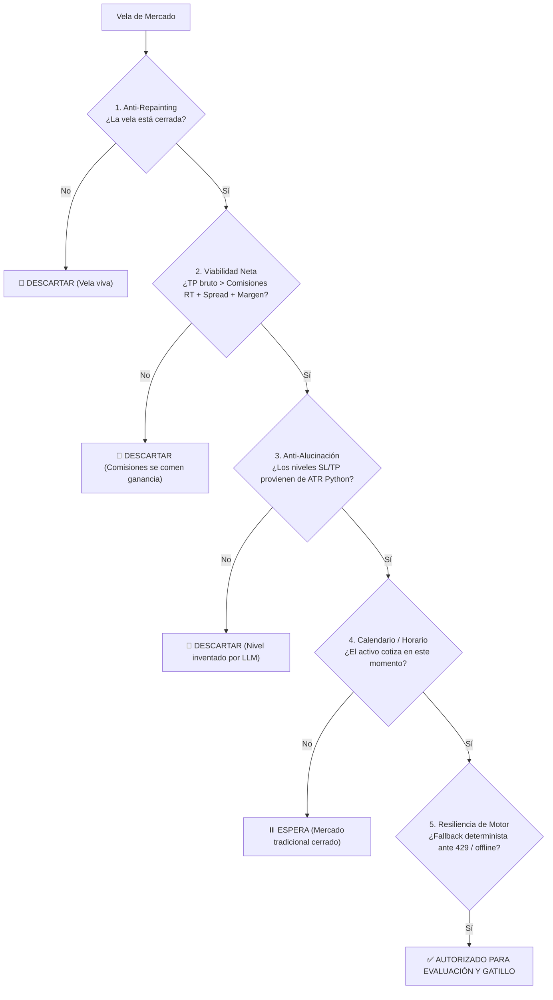

# Guía Maestra y Registro Histórico de Auditorías Cuantitativas

> [!IMPORTANT]
> **REGLA DE MANTENIMIENTO OBLIGATORIO (LIVING DOCUMENT):**
> Este documento es la fuente única de verdad sobre las auditorías arquitectónicas, financieras y técnicas de `trading_ollama` y su puente con `monitor del mercado`.
> **Cualquier agente de IA (Antigravity, Argon, Claude, GPT), desarrollador o colaborador que realice una auditoría, refactorización crítica o corrección de bugs DEBE registrar obligatoriamente su intervención en la [Parte 2: Bitácora Histórica](#parte-2-bitácora-histórica-de-auditorías) antes de dar la tarea por concluida.** Queda terminantemente prohibido alterar fórmulas financieras, motores de decisión o puentes HTTP sin asentar la justificación y los tests de verificación en este archivo.

---

## 🧭 Parte 1: Guía Maestra de Inspección y Checklist Cuantitativo

Cualquier auditor que ingrese a este proyecto debe verificar estos **6 puntos de control ciego** antes de autorizar cambios en producción:

### Checklist Rápido de 7 Puntos:

1. **Soberanía Matemática vs. Alucinación de LLM:**
   - La IA generativa (Ollama, Gemini, DeepSeek) **nunca** calcula Stop Loss ni Take Profit por texto libre.
   - Los niveles deben provenir del código determinista en Python (`contrarian_evaluator.py`, `quant_analysis.py`) basados en múltiplos del **ATR Wilder**.
   - Si la IA sugiere `COMPRAR`, la Trinchera matemática tiene poder de veto absoluto si las comisiones o el spread vuelven inviable la operación.

2. **Comisiones Round-Trip y Spread Estricto:**
   - Prohibido el doble descuento y prohibido ignorar el costo de salida.
   - Cada análisis debe calcular:
     $$\text{Costo RT} = (2 \times \text{Comisión}) + (2 \times \text{Spread})$$
     $$\text{TP Neto} = \text{TP Bruto} - \text{Costo RT} \ge \text{Margen Mínimo (ej. } 0.15\%)$$
   - Si $\text{TP Neto} < \text{Margen Mínimo}$, la orden debe ser abortada automáticamente.

3. **Aislamiento Anti-Repainting (Velas Cerradas):**
   - El bot debe alimentar sus indicadores exclusivamente con velas ya cerradas (`df.iloc[:-1]`).
   - La vela en formación (índice `-1`) solo se consulta para obtener el precio actual de ejecución (`close` o `bid/ask`), nunca para recalcular medias ni osciladores cuyo valor muta mientras la vela no expire.

4. **Integridad de la Bóveda Contable (Ledger SQLite):**
   - Toda mutación de saldo o registro de trade debe operar bajo transacciones atómicas de SQLite en modo `WAL`.
   - Prohibido manipular saldos en memoria volátil de JavaScript o Python sin reconciliación estricta con la base de datos `backend/data/trading_ledger.db`.

5. **Resiliencia de APIs y Failover Silencioso:**
   - Toda llamada a APIs externas (Google Gemini, feeds de noticias) debe tener un **timeout estricto $\le 12\text{s}$**.
   - Forzado de sockets IPv4 (`AF_INET`) en entornos Linux para prevenir congelamientos de 45 segundos por descarte de paquetes IPv6 TCP SYN.
   - **Failover 429 Obligatorio:** Ante agotamiento de cuota de cualquier LLM externo, el sistema conmuta automáticamente al motor cuantitativo determinista o al motor local sin colgar el ciclo.

6. **Filtro de Horarios Bursátiles vs. Cripto 24/7:**
   - El Modo Inteligente de auto-ruteo debe discriminar si el activo sugerido pertenece a Wall Street (NASDAQ, NYSE) o al mercado cripto. Si es fin de semana o fuera de hora de mercado, la directiva se retiene en buzón y la operativa en vivo permanece en el activo 24/7 activo (ej. BTC/USDT).

7. **Protocolo de Contraste Activo (Prohibido Responder Teoría sin Auditar Código):**
   - Ante cualquier consulta, tabla de riesgo/beneficio o hipótesis planteada por el usuario o equipo, **queda terminantemente prohibido responder con explicaciones teóricas pasivas**.
   - Todo agente está obligado a contrastar de inmediato la hipótesis contra la implementación en el código fuente (`main.py`, `daemon.py`, `quant_analysis.py`, SQLite), detectar cualquier desfasaje o fuga en vivo (ej. cierres prematuros o asimetrías invertidas) y proponer el ajuste costo-beneficio correspondiente antes de cerrar la tarea.

---

## 📜 Parte 2: Bitácora Histórica de Auditorías

A continuación se registran todas las auditorías y avances arquitectónicos que han moldeado el estado actual del sistema:

| Fecha | Auditor / Agente | Módulos Auditados | Resumen del Diagnóstico y Solución Aplicada |
| :--- | :--- | :--- | :--- |
| **2026-10-23** | **Antigravity** | `backend/main.py`, `backend/daemon.py`, `backend/estrategias/`, `frontend/js/app.js`, `tests/` | **Transparencia Anti-Repainting, Destrabe Táctico de Tendencia (SMA50) y Caza Multi-Activo en Modo Inteligente:** 1. **Frente 1 (Agilidad de Tendencia SMA50):** En `trailing_trend_runner`, se reemplazó el bloqueo ciego de la macro EMA200 (50 horas en M15) por una confluencia adaptativa: permite capturar giros tempranos cuando el precio supera la SMA50 con alineación SMA20 y proximidad a la zona de valor (a menos del 1% de EMA200). 2. **Frente 2 (Caza Multi-Activo en Modo Inteligente):** En `daemon.py`, cuando `mode == "smart"` y hay slots libres, el ciclo patrulla concurrentemente la terna líquida (`BTC/USDT`, `ETH/USDT`, `SOL/USDT`). Si el activo base lateraliza o no da setup, pero otro activo líquido da compra válida, ejecuta la orden en el slot libre y auto-rutea la interfaz. 3. **Frente 3 (Claridad Epistémica de Velas Cerradas):** Se explicitó en los logs que el precio evaluado es `Cierre vela {TF} ($X)` adjuntando el `[Tick vivo: $Y]` de CCXT en tiempo real, disipando falsos diagnósticos de congelamiento. 4. **Timeout del Escáner Rápido (:8520):** Ampliado de 6s a 15s en `app.js` para permitir la recopilación de feeds de Yahoo Finance sin falsas alarmas de desconexión. 5. 112 tests de Python y 12 tests de Node.js aprobados al 100%. |
| **2026-10-22** | **Antigravity** | `backend/estrategias/mean_reversion_atr.py`, `backend/backtest.py`, `backend/main.py`, `tests/test_estrategias.py`, `tests/test_regressions.py` | **Desbloqueo de Contradicción Matemática y Blindaje de Volumen en Reversión a la Media (Doble Camino Cuantitativo OR):** 1. Se eliminó la parálisis de `MANTENER` provocada por exigir simultáneamente pánico extremo ($Z \le -2.0$) y tendencia alcista perfecta ($Precio > EMA200$) con un `AND` estricto. 2. Se bifurcó la lógica en dos setups disjuntos: &nbsp;&nbsp;• **Camino A (Pullback en Tendencia Alcista):** $Precio > EMA200$, pendiente $EMA200 \ge 0$, $Z \in [-1.2, -0.4]$, mecha inferior $\ge 0.20$ y volumen controlado ($RVOL \le 3.5$, para descartar avalanchas de venta en retrocesos). &nbsp;&nbsp;• **Camino B (Rebote por Pánico Extremo / Capitulación):** $Z \le -2.0$, mecha de absorción $\ge 0.25$, desacoplado de la $EMA200$ y **sin techo de volumen máximo** (permite capturar flash crashes donde el $RVOL$ explota por liquidaciones institucionales). 3. Se conservaron intactas las compuertas comunes financieras: $R:R_{neto} \ge 1.0$, cobertura de costos $\ge 3.5\times$ ida/vuelta y $TP_{neto} \ge 0.5\%$. 4. Se sincronizó el motor de backtesting offline (`backend/backtest.py`), las suites de regresión y las etiquetas explicativas de setup en `backend/main.py`. 5. 110 tests unitarios/integración en Python y 12 tests en Node.js aprobados al 100%. |
| **2026-10-19** | **Antigravity (skill `web-designer`)** | `trading_ollama/backend` y `frontend` (`daemon.py`, `main.py`, `index.html`, `css/style.css`, `css/tailwind.*`, `tailwind.config.js`, `CONTEXTO.md`) | **Tailwind Compilado, Dependencias Fijadas y Blindaje de Guardián Multi-Posición SL/TP:** 1. `index.html` ya no carga `cdn.tailwindcss.com`. Carga `css/tailwind.css` (35 KB, minificado) **después** de `style.css` para conservar la precedencia de cascada. Documentado en `CONTEXTO.md` (Sección 2). Rebuild al agregar clases nuevas: `npx tailwindcss@3.4.17 -c tailwind.config.js -i css/tailwind.input.css -o css/tailwind.css --minify`. 2. Se fijó `chart.js` a `@4.5.1/dist/chart.umd.min.js` en `index.html` y se añadió `@media (prefers-reduced-motion: reduce)` en `css/style.css`. 3. Captura headless antes/después del dashboard real (0,154 % de píxeles distintos solo en datos en vivo) y 89 tests en verde. 4. **Blindaje de Guardián Multi-Posición SL/TP:** Se implementó `_check_open_positions_protections()` en `backend/daemon.py` para vigilar concurrentemente el Stop Loss y Take Profit de **todas** las posiciones abiertas en SQLite independientemente del símbolo activo. Se implementó `ensure_guardian_running()` y se desacopló `stop()` para mantener el hilo guardián de fondo vigilando el riesgo si el usuario detiene el agente o cierra la pestaña mientras hay trades abiertos. Verificado con tests unitarios concurrentes (89/89 tests aprobados). |
| **2026-10-19** | **Antigravity** | `trading_ollama` (Motor y UI) | **Calibración Asimétrica de Salida (R:R >= 1:2) y Corrección de TP Prematuro:** 1. Corrección crítica en `backend/main.py`: el motor CIO liquidaba prematuramente al tocar `min_profit_pct` (+0.15%), cortando las ganancias en centavos mientras el SL absorbía -0.60% (asimetría invertida detectada empíricamente). Se forzó la salida táctica a exigir `target_tp_pct = max(net_tp, min_profit_pct)`. 2. Actualización de prompts en Ollama/Gemini para sostener trades hacia el TP real. 3. Incorporación de ratios asimétricos nativos en el panel UI (`tpSlSelect`): 1:2 (+1.0% / -0.5%) y 1:3 (+1.5% / -0.5%), fijando default asimétrico en `daemon.py` y `app.js`. 4. 87/87 tests cuantitativos en verde. |
| **2026-10-18** | **Antigravity** | `trading_ollama` / `monitor del mercado` | **Motor Antigravity CIO, Memoria RLVR y Resiliencia 429:** 1. Integración del motor `antigravity_cio` en frontend y backend: ejecución directa de directivas institucionales con 0 tokens por vela. 2. Creación del Gimnasio Evolutivo RLVR (`verificador_evolutivo.py`) con simulación forward, deduplicación y cosecha de `TP_GANADOR` y `VETO_SALVADOR`. 3. Parche IPv4 y failover automático ante cuota 429 en Gemini API. 4. Guardián de fines de semana para activos bursátiles en auto-ruteo. 5. 87/87 tests unitarios en verde. |
| **2026-10-18** | **Argon** | `monitor del mercado` (:8520 / :18087) | **Integración de Fuentes, ATR Determinista y Puente HTTP:** 1. Saneamiento del puente HTTP: envío de header `X-API-Token`, IDs UUID y timestamps ISO-8601 UTC en `server.py`. 2. Expansión del universo a fuentes en español (Ámbito, Investing) y activos clave (NVDA, TSLA, BYMA GGAL.BA/YPFD.BA). 3. Cálculos matemáticos en Python (`MarketDataFetcher` con SMA50, EMA200, Z-Score20, ATR14 Wilder, RVOL20) con TTL de 300s. 4. Niveles deterministas por ATR en `contrarian_evaluator.py` para erradicar alucinaciones del LLM 3B. 5. Filtro en UI descartando tickers no operables (`GENERAL`, `DX-Y.NYB`). |
| **2026-10-17** | **Argon** | `trading_ollama` (`guias/`) | **Auditoría de Estrategia Nasdaq (Franklin Araujo):** Diagnóstico de viabilidad de estrategia de ruptura en apertura NY (VWAP + rango Londres + M15). Se determinó que requiere feed de datos intradiario continuo (sesión asiática/europea) incompatible con el snapshot diario de yfinance, validando la permanencia en el enfoque actual de Reversión a la Media asimétrica ($Z \le -2.0$). |
| **2026-10-16** | **Argon** | `trading_ollama` (Motor Central) | **Auditoría Plan Argon (12h Run Log):** Blindaje de la Trinchera cuantitativa: desactivación definitiva de Kelly fraccional a favor de tamaño de posición fijo por volatilidad, verificación de viabilidad por comisiones round-trip y fallback estricto a `MANTENER` ante datos corruptos. |
| **2026-10-12** | **Claude 3.5 Sonnet** | `trading_ollama` (Backend) | **Modularización y Motor Contable LedgerStore:** Extracción de responsabilidades de `main.py` hacia `quant_analysis.py`, creación del almacén contable SQLite (`LedgerStore`) con transacciones seguras y eliminación de scripts huérfanos. |
| **2026-10-11** | **Claude / Sora** | `trading_ollama` (Seguridad) | **Hardening de Seguridad Financiera y XSS:** Saneamiento de entradas en endpoints REST, sanitización de payloads de análisis en el frontend, prevención de desbordes numéricos y configuración de pre-commit hooks cuantitativos. |

---

## 🚀 Hoja de Ruta Pre-Broker Real (Roadmap Prioritario)

> **Decisión Estratégica Asentada (2026-10-18):**
> Antes de ingresar fondos o conectar un broker real con dinero de inversores/amigos, se debe implementar y certificar la arquitectura multiactivo concurrente y validar el comportamiento de mercado durante las semanas de prueba.

### 1. Proyecto Clave: Arquitectura de Múltiples Posiciones Concurrentes (`portfolio.positions`)
- **Objetivo:** Evolucionar el estado actual del frontend (modo francotirador de una sola posición activa `portfolio.position`) a un array dinámico concurrente (`portfolio.positions`), aprovechando que la base de datos SQLite (`trading_ledger.db`) y el broker (`paper_broker.py`) ya admiten múltiples activos abiertos.
- **Reglas de Gestión de Margen Seguro:**
  - **Máximo de Posiciones Simultáneas:** 3 a 4 activos concurrentes (ej: BTC, SOL, QQQ o Bonos TLT).
  - **Límite de Exposición Total:** Máximo 50% a 70% del capital de la cuenta invertido; el 30% a 50% restante debe permanecer siempre en liquidez defensiva (fiat/USDT) para amortiguar volatilidades.
  - **Independencia de Trades:** Cada posición mantendrá su propio cálculo estricto de Stop Loss y Take Profit por ATR, sin promediar pérdidas en el mismo activo.

### 2. Cronograma de Pruebas Empíricas (Semana 1 y Semana 2)
- **Semana 1 (Apertura de Mercados y Bonos/Acciones):**
  - Monitorear el comportamiento en vivo del CIO y el bot a partir del lunes con la apertura de New York (Nasdaq, ETFs, Bonos).
  - Auditar cómo discrimina horarios bursátiles, cómo veta activos con alerta y cómo gatilla oportunidades con $Z \le -2.0$ y $R/B \ge 1:3$.
- **Semana 2 (Pruebas de Estrés y Multi-Activo):**
  - Implementar y auditar la vista de múltiples posiciones concurrentes en la UI.
  - Verificar la precisión contable de la Bóveda SQLite y el cálculo de Cuotas-Partes (NAV) para los inversores.

### 3. Eje Prioritario Permanente: Estudio Probabilístico de Salidas y Toma de Ganancias (Exit Asymmetry)
- **Directiva Soberana Asentada (2026-10-19):** La salida del trade es el factor determinante de la esperanza matemática ($EV$). Queda fijada como prioridad continua de optimización:
  - **Prohibición Estricta de Ventas Prematuras:** Ningún motor o IA puede autorizar salidas tácticas por debajo del objetivo asimétrico configurado ($\text{Target TP} \ge 1.5\times$ a $2.0\times$ el riesgo del Stop Loss). El umbral `min_profit_pct` solo opera como filtro de viabilidad de entrada, jamás como gatillo de liquidación.
  - **Estudio de Salidas Escalonadas (Peluqueo 50% + Runner a Breakeven):** Investigar y perfeccionar la toma parcial de beneficios: asegurar el 50% en Ratio 1:1.5, subir el Stop Loss del remanente a Breakeven Real ($0 riesgo) y dejar que el resto busque recorridos de $1:3$ o superiores.
  - **Análisis de MFE / MAE en Bitácora:** Auditar periódicamente la Excursión Favorable Máxima (MFE) de los trades ganadores para calibrar si el Take Profit está capturando la cresta del movimiento sin devolver ganancias en retrocesos.

---

## 🛠️ Procedimiento para Agregar una Nueva Auditoría

Cuando completes una nueva auditoría o refactorización:

1. **Añade una fila a la tabla** de la [Parte 2](#parte-2-bitácora-histórica-de-auditorías) con la fecha actual, tu nombre/modelo, los archivos modificados y una síntesis concisa de los hallazgos y soluciones.
2. Si descubriste un nuevo punto de falla recurrente, **actualiza la [Parte 1: Guía Maestra](#checklist-rápido-de-6-puntos)** agregando el nuevo criterio de validación.
3. Asegúrate de que la suite de pruebas (`pytest -q`) termine con **100% de tests aprobados** antes de confirmar el commit.
